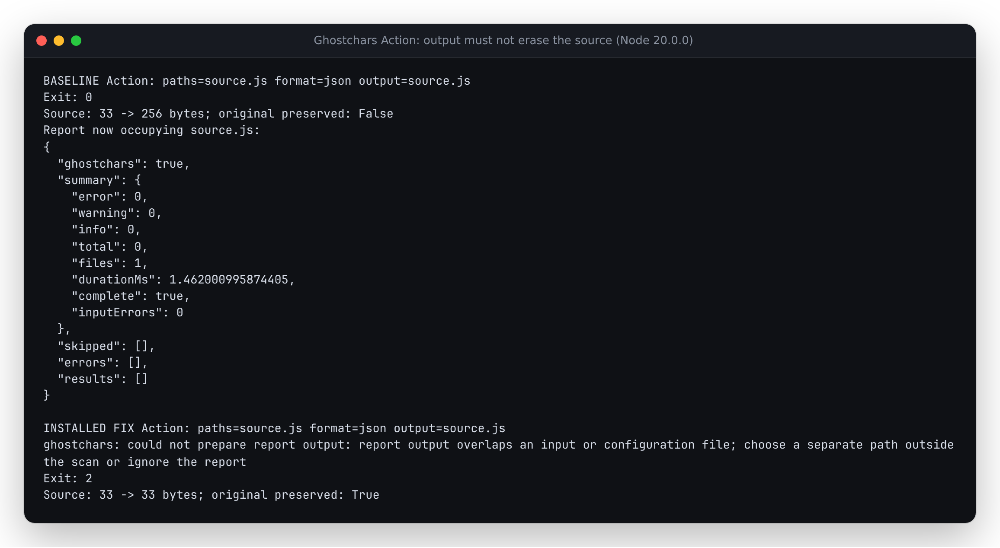

# Write Action reports without erasing the scan inputs

Baseline `14a9f46ab5a57a5bf9f5848e3b5ac2916928e122` implements the Action's
`output` input as shell redirection. Bash opens and truncates that file before
Node starts. When the destination is a selected source file, the scanner reads
an empty file, reports no findings and exits successfully. The input is then
replaced by the clean report. A hard link or a symbolic link to the input has
the same effect.

The Action now passes `--output` to the bundled CLI. The CLI checks the output
against selected and skipped inputs, failed input paths and the explicit or
default Ghostchars configuration. Canonical paths and device/inode identities
cover parent-directory aliases and hard links. A symbolic-link or non-regular
output is refused. Validation happens before `--fix` can change any source.

Once the report is ready, the writer creates an exclusive mode-0600 temporary
file beside its destination, writes and flushes it, rechecks input/destination
identities, then replaces the destination by rename. The temporary file is
removed on an ordinary failure when its identity is still the writer's own.

## Actual Action-body replay

[`replay.py`](replay.py) extracts and executes the actual Bash `run` block from
`action.yml`, supplies the same `GC_*` environment variables, and runs the real
CLI bundle. The inputs are synthetic, disposable Linux files. This is a local
execution of the composite step, **not a hosted GitHub Actions run**; Node setup
and GitHub's annotation/code-scanning services are outside this experiment.

| Reproduced case | Before | After |
| --- | --- | --- |
| Source path, relative/directory path, hard link, symlink, parent alias | Original overwritten; exit 0 | Original retained; exit 2 |
| Binary, invalid UTF-8 or oversized input as destination | Truncated before discovery; empty file called scanned/clean | Original bytes retained; exit 2 |
| Explicit/default config or its hard-link alias | Configuration erased | Configuration retained; exit 2 |
| Invalid configuration with a separate previous report | Previous report truncated to zero | Complete previous report retained |
| Real 2 KiB file-size limit, previous report | 12,800 bytes become 2,048 | All 12,800 bytes retained; exit 2 |
| Same limit, new report path | Partial 2,048-byte report left behind | No output or staging file left; exit 2 |
| Ten ordinary delivery controls | Reports delivered | Same normalized report as direct stdout; finding/incomplete exits retained |

All **26** corrected cases pass. The baseline changes a source or configuration
file in **12** cases, including **nine** actions returning exit 0 after overwriting
a source. It passes the ten ordinary delivery controls. The file-size limit is
an actual kernel `RLIMIT_FSIZE=2048` in the disposable child, with `SIGXFSZ`
ignored so the write error reaches Node. It is not a simulated disk-full or
physical power-loss experiment.

Controls cover all five scan formats, new and existing destinations, a 255-byte
filename, stdout mode, an incomplete-input report and an existing report excluded
by Git ignore policy. Report-file output is compared to the same CLI's direct
stdout report, ignoring elapsed time. Every source/configuration and prior-report
byte check is independent of the report's claims. The receipt retains full small
JSON reports, bounded text previews, file hashes, exit codes and actual errors.
Raw report hashes can differ because they include elapsed times.

Retained captures: [baseline](results/before.json) and
[corrected source](results/after.json), [clean-build and installed-package
receipt](results/verification.json), and [actual local workflow assertions](results/workflow.json).
Package version remains 0.1.5; these are source changes with no registry release
or hosted deployment.



[`demo.py`](demo.py) captures the [unedited report/error output and actual source
byte comparison](results/demo.txt) rendered in this inspected screenshot.

## Clean archive and installed package

Implementation revision `ac5a72a8e38d59d118103a996a079cc5eead0020` was archived
into a fresh directory. With Node 24.21.0, a fresh installation, lint, type
checking, **284 tests in 22 files**, library/CLI builds, benchmark smoke and
package creation all passed. All **327** tracked archive files retained their
exact bytes, including the rebuilt committed CLI.

The local **170,374-byte** npm tarball was installed in a separate directory
with install scripts disabled. All **53** installed runtime files match the
clean build. On **Node 20.0.0** and **24.21.0**, all 26 Action replays have the
same exit, integrity and delivery verdicts. Every protected source/config and
previous-report hash matches the corrected capture. Each of the ten ordinary
deliveries also matches that installed CLI's direct stdout report after timing
normalization. The prior 34-case literal-directory replay still passes on the
installed Node 20 CLI, as do version/reveal and library scan/sanitize examples.

The actual Action self-test job's shell assertions were also executed locally
on Node 20 against the clean archive: source scan exits 0, fixture scan writes
a complete SARIF report with findings and exits 1, and the collision exits 2
while the source matches its original with `cmp`. Checkout/setup-node are
represented by the archive and explicit executable; this does not establish
a hosted workflow result.

Tarball SHA-256:
`9006d29a3e1181f4c0989515933501366a2779b51a6253d1b522ee21ace40f3e`.
Installed CLI SHA-256:
`2d8d3dea74f268cee7485179b7d6ce5b4d6b5c47a61d961af44de2b67fbce267`.

## Reproduce

```sh
git show 14a9f46ab5a57a5bf9f5848e3b5ac2916928e122:dist/cli.js > /tmp/ghostchars-before.mjs
git show 14a9f46ab5a57a5bf9f5848e3b5ac2916928e122:action.yml > /tmp/ghostchars-before-action.yml
python3 studies/action-reports/replay.py --cli /tmp/ghostchars-before.mjs --action /tmp/ghostchars-before-action.yml --expect before --output /tmp/before.json
npm ci && npm run build
python3 studies/action-reports/replay.py --cli dist/cli.js --action action.yml --expect after --output /tmp/after.json
```

`--node /path/to/node` selects an exact Node executable for every invocation,
including the `node` command inside the Action body. The replay stages an
identical copy of the chosen CLI at the Action's expected `dist/cli.js` path.

## Boundaries

- An existing report inside the selected scan is an input and is refused as
  output. Put reports outside the scan or explicitly ignore them. The SARIF
  workflow example now uses `${{ runner.temp }}`.
- An incomplete scan still writes its structured evidence with exit 2. A usage
  or configuration error before scanning leaves an earlier report untouched.
- `--fix` repairs and the report are separate operations. A later report-write
  failure does not roll back completed repairs. The preflight prevents a known
  input/output collision from starting repairs.
- Existing report metadata is not copied; replacement creates a new inode owned
  by the process, mode 0600 on POSIX. Source repair metadata rules are unchanged.
- Snapshot/recheck guards notice changes but are not an atomic filesystem
  sandbox. Abrupt termination can leave a temporary file. File flushing and
  rename are not proof of power-loss durability or network-filesystem semantics.
- External shell `>` redirection still happens before the CLI starts. The
  protections apply to `--output` and the Action's `output` input.
- Browser runtime code is unchanged. The replay makes no Windows/macOS,
  registry-release or hosted-demo validation claim.
