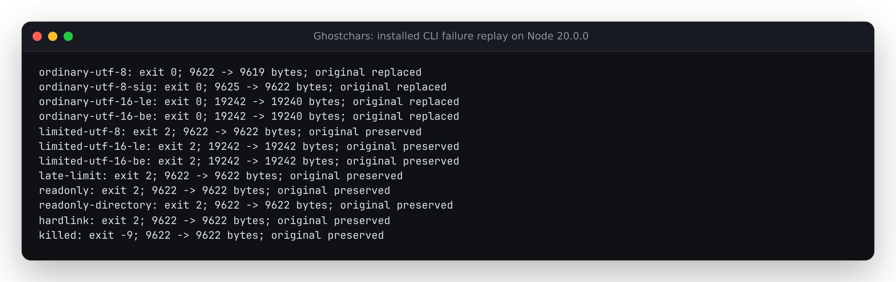

# Preserve originals when a repair write fails

Baseline `94580b4718596f9c464883813ad2e79664af64d7` writes repaired bytes with
`writeFileSync(path, bytes)`. Opening an existing path for that write truncates
it before the replacement bytes have reached storage. Returning an error does
not restore the original.

The retained Linux replay uses synthetic source files containing one U+200B
and 200 ordinary comment lines. It sets a **real kernel** `RLIMIT_FSIZE=1024`
only in the disposable CLI child. There is no mocked write error in that case.

| Case | Baseline | Staged replacement |
| --- | --- | --- |
| UTF-8, write limit | Exit 2; 9,622 bytes become 1,024 | Exit 2; all 9,622 original bytes retained |
| UTF-16 LE/BE, write limit | Exit 2; 19,242 bytes become 1,024 | Exit 2; all 19,242 original bytes retained |
| Small file before a file exceeding the limit | Small file repaired; large file truncated | Both originals retained |
| SIGKILL after writing 32 bytes | Original truncated to 32 bytes | Original retained; one private 32-byte temporary file remains |
| Read-only original | Refused | Refused, even with a writable parent |
| Read-only parent | In-place repair succeeds | Refused before changing the original |
| Hard-linked original | Both names observe the repair | Refused; both names and original bytes retained |
| Ordinary UTF-8, UTF-8 BOM, UTF-16 LE/BE | Correct repair | Identical repaired bytes; mode 0751 and owner/group retained |

The SIGKILL preload injects **when** the process is killed, immediately after a
real 32-byte write. This proves process-interruption behavior during staging;
it is not a power-loss, physical disk-full, or filesystem-corruption experiment.
`replay.py` checks exact bytes, SHA-256 hashes, exit codes, mode, ownership,
hard-link aliases and temporary-file leftovers, using an unprivileged Linux
account. All fixtures are disposable and removed by the parent process.



Retained outputs: [baseline Node 20](results/before-node20.json),
[installed Node 20](results/installed-node20.json),
[installed Node 24](results/installed-node24.json), and
[clean-build/package byte comparisons](results/artifacts.json).
The [verification record](../../docs/verification-atomic-repair-2026-10-12.md)
links the clean checks and their commands. Package metadata remains at 0.1.5;
these results describe source changes and a locally packed artifact.

## Replacement protocol

1. Read and decode every input; an incomplete scan still blocks all repairs.
2. Recheck original bytes, identity and metadata; open without truncation to
   verify write access. Refuse symbolic paths, non-regular files and hard links.
3. Create an exclusive mode-0600 temporary file in the same directory. Write
   the complete replacement, restore supported metadata, flush, and close it.
4. Prepare every file before replacing any original. Recheck the entire batch
   for noticed changes, then rename each prepared file over its original.
5. On failure, attempt to remove uncommitted temporary files. Do not delete a
   visibly different inode that has appeared at a temporary path.

The unit fault checks use real files with injected failure points: partial
ENOSPC, flush EIO, rename failure on the first or second file, an external edit
during staging, and replacement of a temporary pathname. They supplement the
kernel and process replay rather than standing in for it.

## Reproduce

Use a fresh source build or the CLI from a locally packed and installed package.
The baseline bundled CLI is byte-identical to its rebuilt version:
SHA-256 `d3ccd26aa81a7ffd8a2b50466f303dd27a0e5c10efcad816bd3b7cfd0956e658`.

```sh
git show 94580b4718596f9c464883813ad2e79664af64d7:dist/cli.js > /tmp/before-cli.mjs
python3 studies/atomic-repair/replay.py --node "$(command -v node)" --cli /tmp/before-cli.mjs --expect before --output /tmp/before.json
npm run build
python3 studies/atomic-repair/replay.py --node "$(command -v node)" --cli dist/cli.js --expect after --output /tmp/after.json
python3 studies/atomic-repair/measure.py --node "$(command -v node)" --before /tmp/before-cli.mjs --after dist/cli.js --output /tmp/timing.json
```

The replay requires Linux, an unprivileged account and Node >=20. The timing
probe compares five alternating fresh batches of 200 synthetic files per
version, verifying every repaired byte after each run. It includes CLI startup,
scanning and JSON output; fixture creation and verification are outside the
timed region. Results are specific to the tested WSL2 filesystem.

On this WSL2 Linux host (14 logical CPUs, approximately 47 GiB RAM), the final
installed Node 24.21.0 comparison took a
median **830.7 ms before** and **3,065.5 ms after** for 200 repaired files.
Every file was 9,622 bytes before repair; all 2,000 before/after outputs matched
the expected bytes. Extra staging, rechecks and per-file flushing add real I/O
cost. [All ten timings and exact CLI hashes](results/installed-performance.json)
are retained; this is not a scanner-speed improvement or a general storage
benchmark.

## Boundaries

Each replacement changes the inode. POSIX owner/group and permission bits are
preserved or the stage fails. Extended attributes, ACLs and alternate data
streams are **not copied**. Hard links are refused to avoid silently severing
an alias. A writable parent is now required. Files relying on extended metadata
need a metadata-aware editing workflow.

There is no multi-file transaction, backup or compare-and-swap against a
concurrent editor. A later rename failure can follow successful earlier
repairs. SIGKILL can leave temporary files. Flushing a file without a directory
durability protocol is not proof of persistence through power loss. Network
filesystems may report an error after committing a rename; a repair error
therefore asks the user to inspect the reported paths before retrying.
The retained replay makes no Windows/macOS runtime claim.

References: [Node filesystem flags and writes](https://nodejs.org/api/fs.html),
[Linux resource limits](https://man7.org/linux/man-pages/man2/setrlimit.2.html),
and [rename replacement semantics and NFS caveat](https://man7.org/linux/man-pages/man2/rename.2.html).
