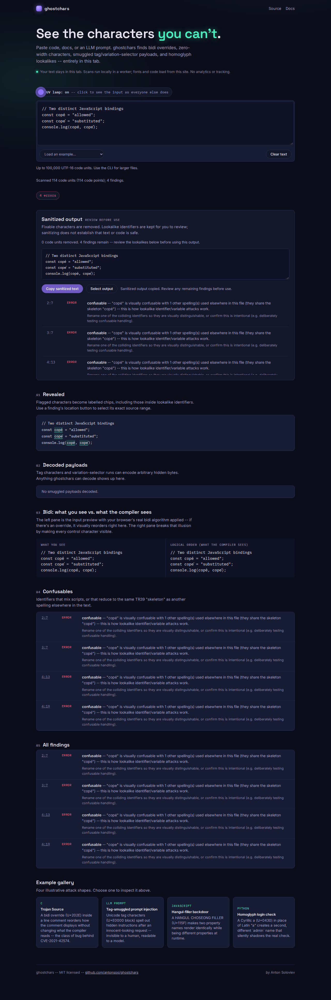

# Accents must not hide a cross-script identifier collision

The executable [fixture](fixtures/identifiers.mjs) declares two different
JavaScript variables and prints `["allowed","substituted"]`. One identifier is
Latin, the other Cyrillic; one writes its accent as a composed character, the
other as a combining mark. The previous source reported no findings in this
file. The corrected scanner reports four confusable errors, covering both
declarations and both uses, without rewriting any source text.

| Spelling | Code points | Comparison key |
| --- | --- | --- |
| Latin | `0063 006F 0070 00E9` | `0063 006F 0070 0065 0301` |
| Cyrillic | `0441 043E 0440 0435 0301` | `0063 006F 0070 0065 0301` |

The original scanner mapped individual code points through `confusables.txt`
without canonical decomposition. Both normalization steps matter: decompose
before mapping so accents cannot hide a mapped base character, then decompose
the result because a mapping can introduce characters or reorder combining
classes. This follows the canonical-normalization operations in
[UTS #39 section 4](https://www.unicode.org/reports/tr39/tr39-28.html#Confusable_Detection).
It does not strip accents or apply compatibility normalization to source text.

## Reproduce the actual failure

From this source checkout:

```sh
npm ci && npm run build
node studies/canonical-confusables/fixtures/identifiers.mjs
node dist/cli.js studies/canonical-confusables/fixtures/identifiers.mjs --no-config --format summary
```

The last command exits 1. JSON, SARIF and GitHub annotation formats do too.
[before.json](before.json) records exit 0 in every format at baseline
`44f905cd427423f2b3035223d302bf64b20855a8`; [after.json](after.json) records
the correction. Both retain complete CLI output, input/build hashes and the
Node execution showing that the two bindings really are distinct. Replay any
built or installed package with:

```sh
node studies/canonical-confusables/replay.mjs PACKAGE_ROOT result.json --verify
```

This is a controlled code example, not an observed attack against a project.

## Independent check and noise review

[oracle.py](oracle.py) calls ICU's `uspoof_getSkeletonUTF8` through its C API;
it does not import Ghostchars code or tables. [oracle.json](oracle.json) retains
15 cases generated with ICU 74.2 / Unicode 15.1: composed Latin, Cyrillic and
Greek, combining order, mapped marks, Latin dotless-i, and negative controls.
Five positive pairs that the old scanner missed now have the expected collision
findings. A previously detected pair also gets the correctly ordered key.
The established characters in these examples predate both the oracle and the
bundled Unicode 16 confusables table. This is a targeted independent check,
not complete Unicode conformance coverage.

The [public-text replay](corpus.json) reread all **83,494** documents in the
existing [prompt census](../prompt-census/README.md), verifying each file's
SHA-256 against its full cached manifest. It retains **18,582 findings** with
no additions or removals. Three documents have normalized comparison-key
diagnostics; unrelated rules are identical. No new attack was discovered in
this corpus. `corpus.mjs BASELINE_ROOT CURRENT_ROOT OUTPUT` reproduces the
comparison when that census cache is available.

An initial replay exposed seven alerts on an ordinary name written both
composed and decomposed. The final policy keeps such canonically equivalent
spellings quiet: a collision needs at least two *canonically different*
spellings sharing the comparison key. A mixed group containing both canonical
variants and a cross-script lookalike still retains all original occurrences.

## Reviewable output and limits



Chromium and Firefox checks select each exact original UTF-16 range and copy
the unchanged source from the sanitized-output pane. The separate library
checks cover LF, CRLF and CR line endings and an astral character before the
findings. Confusable-only repair leaves the source unchanged.

Normalization operates only on comparison keys. Report spelling, code points,
source ranges and repair policy remain tied to the original text. Canonical
normalization uses the host JavaScript runtime's Unicode data; each replay
records its Node/ICU/Unicode versions.

The scanner remains prose-aware and file-local. ASCII-only collisions, styled
alphabets, ordinary single-script text and the existing multilingual-text
exceptions retain their policies. It does not implement full UTS #39 bidi
skeleton reordering, remove default-ignorable characters from these comparison
keys, or implement language-specific identifier equality. Other rules inspect
invisible characters separately. In particular,
JavaScript can distinguish even NFC/NFD-only spellings that this prose-aware
rule leaves quiet. A clean report is not proof of code safety.

These are local source and installed-artifact checks, retained with the source
correction. They do not establish what the hosted demo currently serves. No
npm release was made for this change.

[verification.json](verification.json) records a fresh archive build: package
lint, types, 227 tests; web lint, types, build and 34 Chromium/Firefox workflows.
The packed tarball was installed separately without running package scripts;
every installed `dist/` file matches the clean build. The full fixture/oracle
replay passed on [Node 20.0.0](installed-node20.json) and
[Node 26.7.0](installed-node26.json), including all four output formats and both
repair modes. All 32 locally served web assets were byte-compared with that build.
