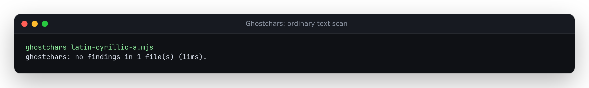
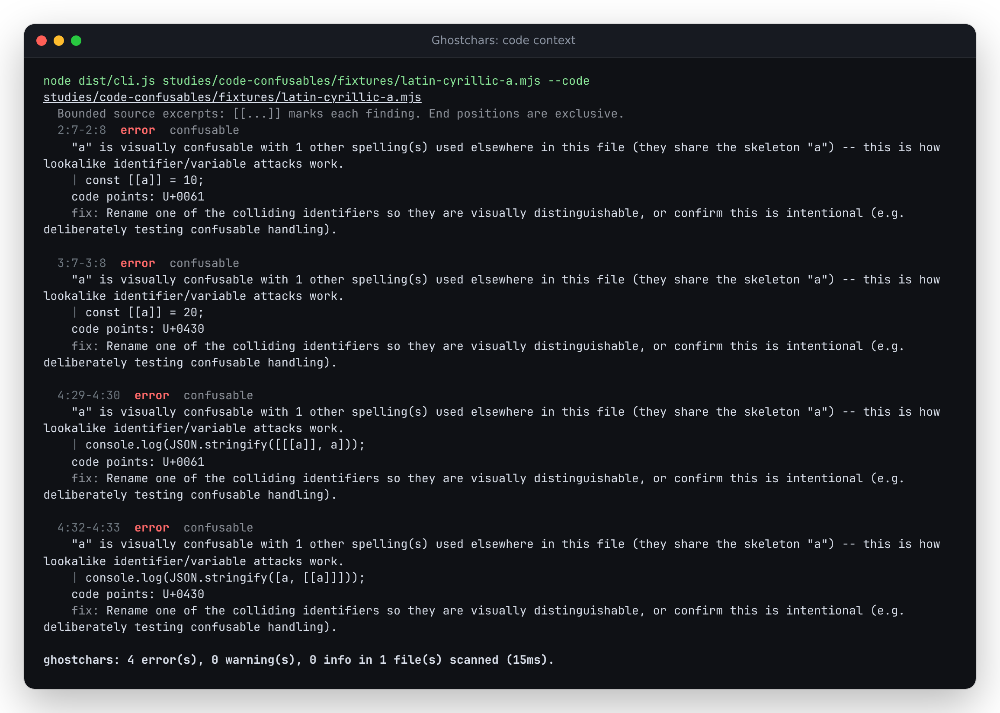

# Confusable code identifiers need an explicit context

A native JavaScript program can hold Latin `a` and Cyrillic `а` as two different
bindings. The baseline scanner at `69905ee` reports no findings. The unused
library option `isCode: true` also does nothing on that revision.

```js
const a = 10;
const а = 20;
console.log(JSON.stringify([a, а])); // [10,20]
```

The source CLI now accepts `--code`, the library honors `isCode: true`, and
configuration can apply it to selected files. The four declarations/references
above receive error-level collision findings, with original UTF-16 spans.
Neither scan nor repair renames either binding. Terminal findings also print
bounded `U+XXXX` labels, so identical-looking glyphs can be told apart.





## Why this is explicit

The text policy deliberately leaves short tokens, decoration, canonical
variants and same-script words quiet. A file with enough Russian, Greek or
Turkish vocabulary also receives language-context exemptions. Those rules
reduce prose noise but are poor evidence that source identifiers are safe.

An [unconditional short-token experiment](results/unconditional-prototype.json)
added 744 findings across 27 of 83,494 public documents, mostly ordinary prose
and mathematical notation. It is not the final implementation, and the added
findings are not labelled attacks. The final default policy keeps **every
complete scan output identical**, including all 18,610 findings; the
[full pinned-corpus receipt](results/default-corpus.json) records matching input
and output digests. These are existing development documents, not held-out
attack-discovery evidence.

Code mode keeps the existing mixed-word check but removes the collision
exemptions. Tokens use Unicode `ID_Start`/`ID_Continue`, with `$`/`_` starts and
`$`/ZWJ/ZWNJ continuations. General-category letters alone miss valid native
identifiers such as `Ⅰ` (letter-number) and `℮` (`Other_ID_Start`). Dollar signs
stay in the token, so locations select `$a`/`$а` and `a$`/`а$` in full.

This follows the identifier property distinction in
[ECMAScript's lexical grammar](https://tc39.es/ecma262/multipage/ecmascript-language-lexical-grammar.html#sec-names-and-keywords).
Collision keys retain the project's existing canonical decomposition and
prototype mapping, described by [UTS #39](https://www.unicode.org/reports/tr39/tr39-32.html#Confusable_Detection).
This does not establish complete conformance to either specification.

## Use it from a source build

```sh
npm ci && npm run build
node dist/cli.js studies/code-confusables/fixtures/latin-cyrillic-a.mjs --code
```

The second command exits **1** because it reports four error-level findings.
Without `--code`, the same file retains its ordinary-text result (exit 0).
The existing `--format json|sarif|github|summary` formats work in code mode.

```js
import { scanText, sanitize } from './dist/index.js';

const source = 'const a = 10; const а = 20;';
scanText(source, { isCode: true }).findings.length; // 2
sanitize(source, { scanOptions: { isCode: true } }).text === source; // true
```

For a mixed repository, `.ghostcharsrc.json` can select the relevant paths:

```json
{
  "overrides": [
    { "files": ["src/**"], "isCode": true },
    { "files": ["src/locales/**"], "isCode": false }
  ]
}
```

All matching overrides apply in order; a later explicit `false` restores text
mode. The flag `--code` selects code mode for every scanned input, overriding
configuration. Invalid values such as `"isCode": "yes"` exit 2 before repair.
Existing rule disabling, severity overrides and scalar allowlists still apply.
The GitHub Action reads this configuration and runs its committed CLI bundle.

## Native evidence and replay

[`oracle.py`](oracle.py) uses the installed ICU C API without reading Ghostchars
code or tables, and executes every fixture with Node. The
[oracle receipt](results/oracle.json) records ICU 74.2 / Unicode 15.1 and Node
26.7.0, the original file hashes, equal skeletons and actual `[10,20]` values.
These established characters predate both tables; this is not a claim that
ICU 15.1 and the vendored Unicode 17 mappings agree in general.

| Retained native pair family | Pairs | Ordinary text / old inert `isCode` | Explicit code mode |
| --- | ---: | --- | --- |
| Short cross-script names, including an accented name | 5 | Quiet | Four exact spans per fixture |
| Ligature, styled and fullwidth names | 3 | Quiet | Four exact spans per fixture |
| Canonical single-letter and word variants | 2 | Quiet | Four exact spans per fixture |
| Same-script Greek and Hebrew names | 2 | Quiet | Four exact spans per fixture |
| Letter-number and Other_ID_Start symbol | 2 | Quiet | Four exact spans per fixture |
| Dollar prefix and suffix | 2 | Quiet | Four complete token spans per fixture |

[Before](results/before.json) records all sixteen missed pairs; the old CLI has
no `--code` flag. [After](results/after.json) records none missed, actual CLI
JSON parity, other formats, configuration precedence, invalid-config refusals,
unchanged confusable repairs and removal of an unrelated invisible character.

```sh
python studies/code-confusables/oracle.py --out /tmp/code-oracle.json
node studies/code-confusables/replay.mjs . /tmp/code-replay.json --verify
node studies/canonical-confusables/corpus.mjs BASELINE_ROOT . /tmp/default-corpus.json
```

The corpus command needs the existing hash-pinned
[prompt-census cache](../prompt-census/README.md). Use a built `69905ee` checkout
as `BASELINE_ROOT`. Fixtures are controlled examples, not discovered attacks.

## Measured cost

The [local measurement](results/performance.json) builds valid block-scoped
repetitions of the sixteen native examples and checks their syntax with Node.
On this 14-vCPU, 48-GB WSL2 host, a 203,800-byte input takes a median 16.61 ms in
text mode and 49.55 ms in code mode, which constructs 6,400 collision findings.
Seven samples follow four warmups; I/O and report formatting are excluded.
These controlled timings are not a general throughput benchmark or a claim
that code mode is as cheap as suppressing those findings.

## Clean install and installed CLI

The [artifact receipt](results/verification.json) identifies implementation
`0a28874`. A fresh archive on Node 24.21.0 passes install, lint, both type checks,
all 387 tests, library/CLI builds and a clean 45-file self-scan. A separate clean
web install passes lint, types, build and all 42 Chromium/Firefox workflows.
Both terminal screenshots were opened and inspected.

Every installed `dist/` file matches the clean build byte-for-byte after packing
and installing with `--ignore-scripts`. The actual installed CLI passes all
sixteen native pairs, formats, configuration and repair controls on
[Node 20.0.0](results/installed-node20.json) and
[Node 24.21.0](results/installed-node24.json). This is a local tarball with version
metadata 0.1.5, not the existing registry package.

## Scope and limits

- Code mode identifies raw candidate spellings. It does not parse declarations,
  resolve scopes, distinguish comments/strings, or decode source-language escapes.
- Identifier equality varies by language. JavaScript distinguishes the retained
  canonical/styled variants; Python normalizes some identifiers. A finding asks
  for review, not a claim that every pair creates distinct bindings everywhere.
- ASCII-only lookalikes remain excluded. The existing confusable mappings,
  host-runtime Unicode properties and normalization determine coverage. This
  does not implement bidi skeleton reordering or prove absence of deception.
- A finding is not evidence of malicious intent. Applying code mode to prose
  can intentionally produce more noise; use per-file configuration.
- The browser retains the ordinary text policy. The
  [existing-demo byte receipt](results/existing-demo-bytes.json) matches all
  32 baseline build files at the canonical public URL; it does not publish this
  new CLI feature. [Six current public workflows](results/existing-demo-browser.json) preserve
  registered variants; the earlier canonical/script-alternative cases were
  also rerun successfully in both engines.
- The npm registry package remains unchanged. Version metadata `0.1.5` does not
  identify this new source behavior.
