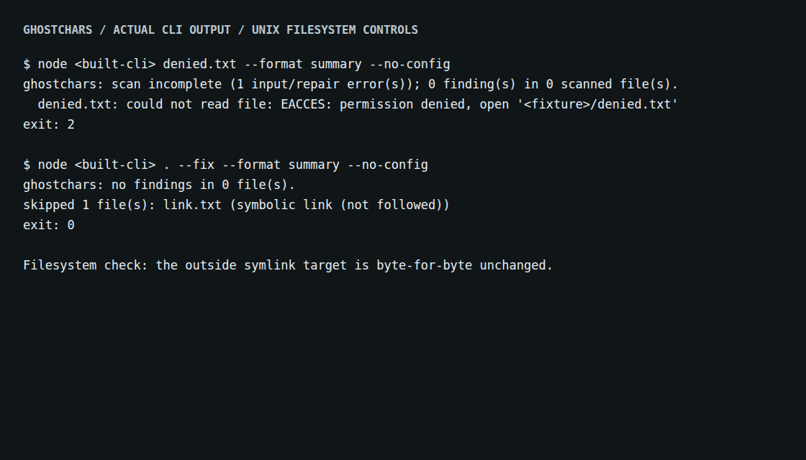

# An unreadable file is not a clean scan

At baseline `dd14d05`, an unreadable text file was classified as binary and
returned exit 0. An unreadable directory disappeared from the scan without
even a skipped-path record. In a Git checkout, `--fix .` followed tracked
symbolic links and modified their targets outside the checkout.

Source commit `2d59e9e` separates input failures from deliberate exclusions and
prepares repairs only after discovery and reading finish. These are source
changes, not an npm release. The reproductions use temporary files created
for this study; no user files or actual hostile repositories were modified.

## Actual filesystem results

[`replay.py`](replay.py) uses real Unix permissions, symbolic links, Git indexes,
and child CLI processes. Expected file bytes are specified independently of
Ghostchars. Permission changes are restored before each fixture is deleted.
The script refuses to run as root or on non-Unix systems rather than treating
unenforced permission failures as passing evidence.

| Scenario | Baseline | Corrected CLI |
|---|---|---|
| Unreadable file, each of five output formats | Exit 0; classified as binary | Exit 2; the failed input remains visible |
| Unreadable subdirectory | Exit 0; directory omitted | Exit 2; directory traversal failure recorded |
| Unreadable ignore policy | Repairs a file the policy was meant to exclude | Exit 2; no planned repair applied |
| Valid fixable file followed by invalid UTF-8 | Exit 2 after already repairing the first file | Exit 2; both files retain their original bytes |
| Tracked symlink to an outside file | Rewrites the outside target | Lists the link as excluded; target unchanged |
| Explicit file/directory link or link in a parent path | Follows it and repairs the target | Refuses with exit 2; asks for the real path |
| Tracked directory replaced by a link | Repairs its outside descendant | Excludes both the link and indexed descendant |
| Corrupt Git index | Switches to a filesystem walk and repairs files | Exit 2; no silent change of selection policy |
| Binary/oversized inputs; regular and UTF-16 repairs; Git ignore; clean text | Existing behavior | Preserved |

There are [24 retained cases](results/before.json). The baseline disagrees with
18 complete case contracts, including report metadata and URI encoding; this
does **not** mean 18 separate vulnerabilities. Eight cases change bytes the
contract says must stay unchanged. The [corrected CLI](results/after.json)
satisfies all 24 contracts and all expected byte comparisons.



The [terminal capture script](capture-terminal.mjs) renders the actual child
process output and records it in [terminal.txt](results/terminal.txt). `<built-cli>`
and `<fixture>` replace machine-specific executable and temporary directory
paths. The byte-preservation line comes from the capture harness, not the CLI.

## Report and repair contract

| Output | Failed input | Deliberate exclusion |
|---|---|---|
| JSON | `summary.complete: false`, `summary.inputErrors`, top-level `errors` | `skipped` |
| SARIF | `invocations[].executionSuccessful: false` and error-level `toolExecutionNotifications` | `runs[].properties.skipped` |
| GitHub | Escaped `::error` annotation for each failure | A notice with a bounded path summary |
| Pretty / summary | Explicit incomplete-scan message and each failed path | Skipped-path summary |
| Dry run | Exit 2 and an incomplete-preview notice; valid-file previews can still be inspected | Skipped-path reasons |

`complete: true` is scoped to eligible inputs; it never asserts that excluded
binary, oversized, linked, or special files were analyzed. Error-level Unicode
findings return exit 1 after a successful scan. Input or repair failures take
precedence and return exit 2. The counts and findings still describe the original
text, including when a repair succeeds.

Files discovered as links are excluded. A link explicitly requested on the
command line is an error, so an explicitly named link cannot count as analyzed.
The checks include parent directory links, and compare link metadata rather
than treating filesystem case canonicalization as proof of a link.

Discovery and input-reading errors prevent every prepared write. Before each
write the CLI rechecks for links and changed bytes. Writes remain in place;
a write failure can leave earlier writes applied. This is not an atomic
transaction or an adversarial filesystem sandbox. Hard links retain normal
in-place file semantics. No claim is made about races between the final check
and the write, or about Windows junction/permission behavior from this Linux run.

SARIF now uses the maintained [OASIS schema](https://docs.oasis-open.org/sarif/sarif/v2.1.0/errata01/os/schemas/sarif-schema-2.1.0.json).
Its [invocation contract](https://docs.oasis-open.org/sarif/sarif/v2.1.0/os/sarif-v2.1.0-os.html)
distinguishes tool execution failures from findings. Actual incomplete and
finding-bearing outputs are validated against that schema, with URI format
checking; `name #100%.txt` is retained as `name%20%23100%25.txt`.

## Compatibility and installed verification

The [previous repair-policy replay](../repair-policy/README.md) still satisfies
all 39 contracts, including exact output bytes for 13 TypeScript translation
catalogs. Those catalogs contain real translated messages with deliberately
inserted controls; this is repair compatibility, not a new detection-accuracy
measurement. [Fresh replay](results/repair-compatibility.json).

The package is built from a clean archive, with its committed single-file CLI
checked byte-for-byte against a fresh build. A separately installed tarball is
replayed on the current runtime and the declared minimum Node 20.0.0.
The retained [verification record](results/verification.json) gives the exact
checks and artifact hashes; [installed](results/installed.json) and
[minimum-runtime](results/installed-node20.json) contain every filesystem result.

## Reproduce

```bash
npm ci
npm run build
python3 -I studies/discovery-evidence/replay.py dist/cli.js --label checkout
python3 -I studies/repair-policy/verify.py --cli dist/cli.js --output /tmp/repair-check.json
```

The filesystem replay needs a non-root Unix account and Git. It restores all
permissions on its own temporary fixtures. Pass `--node /path/to/node` for
another runtime. To compare the baseline, extract `dd14d05` to a separate
directory and pass its committed `dist/cli.js`; it needs no install or build.
Terminal capture additionally needs `npm ci --prefix web` and Chromium installed
for Playwright, then `node studies/discovery-evidence/capture-terminal.mjs dist/cli.js`.
