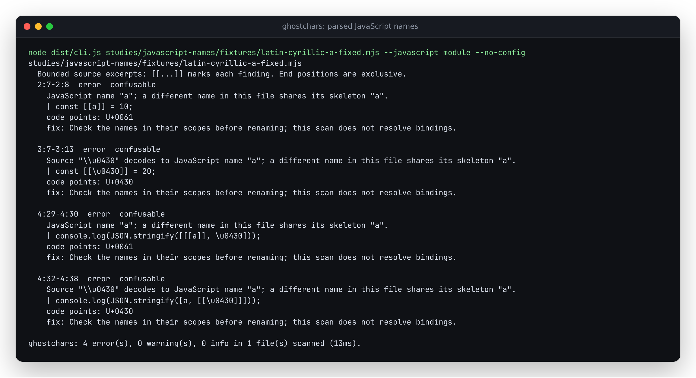

# Compare the JavaScript names behind escaped source spellings

This native program prints `[10,20]`, yet the previous explicit code scan at
`e12e0708a57296cd0d7bb3d079663caf7250a4c6` reports no confusable names:

```js
const a = 10;
const \u0430 = 20;
console.log(JSON.stringify([a, \u0430]));
```

The second name decodes to Cyrillic small letter a, U+0430. Its source consists
of six ASCII characters. A raw character scan cannot compare it with Latin a
as JavaScript does. This was an explicit limitation of `--code`, which remains
a language-independent candidate scan.

The new **source-only, unreleased** JavaScript mode parses before comparing
names. It reports the four original declaration/reference spans, with U+0061
and U+0430 labels and the decoded name beside the escaped source spelling.



## Use from a source build

```sh
npm ci && npm run build
node dist/cli.js studies/javascript-names/fixtures/latin-cyrillic-a-fixed.mjs --javascript module --no-config
node dist/cli.js studies/javascript-names/fixtures/latin-cyrillic-a-fixed.mjs --javascript module --format json --output /tmp/javascript-names.json
```

The two scans exit 1 because the control has error-level findings. JSON keeps
the original UTF-16 ranges, decoded Unicode code points, skeleton and `decoded`
name for escaped spellings. The existing pretty, summary, SARIF and GitHub
formats remain available. Select the grammar explicitly:

| Argument | Grammar |
| --- | --- |
| `--javascript module` | ECMAScript module, including its strict-mode rules |
| `--javascript script` | Ordinary script; permits legacy HTML comments |
| `--javascript commonjs` | CommonJS function-body context, including top-level return |

TypeScript, JSX, malformed escapes and unsupported syntax produce an
incomplete report and exit 2. Valid files' findings remain in a mixed-file
report, while failed files appear in its `errors` list. No fallback converts a
syntax failure into a clean raw scan. This mode refuses `--fix` and `--dry-run`;
the source and its identifier spellings remain intact.

The separate library entrypoint uses the same implementation:

```js
import { scanJavaScript } from './dist/javascript.js';

const result = scanJavaScript(String.raw`const a = 10; const \u0430 = 20;`, {
  sourceType: 'module',
});
result.findings.map(f => [f.start.offset, f.end.offset, f.decoded]);
// [[6, 7, undefined], [20, 26, "\u0430"]]
```

Installed consumers import
`@antonsoloviev/ghostchars/javascript`. The existing registry version predates
this entrypoint. The ordinary main library entrypoint and browser do not import
the parser. Rule severity overrides and allowed code points apply to both raw
and parsed observations; allowed code points refer to the decoded identifier
when the finding concerns a name.

## What is compared

Acorn 8.19.0 parses ECMAScript 2026 using the selected grammar. The walker takes
`Identifier` and `PrivateIdentifier` names and ranges from its AST. This includes
property names such as `box.default`; lexical keyword tokens alone would miss
them. Shorthand properties and import/export nodes can represent one occurrence
twice, so equal source occurrences are retained once. Private names include `#`
in their comparison keys and do not collide with public names.

Unicode escapes contribute their decoded code points. Different escape
spellings of one name, such as `a`, `\u0061` and `\u{61}`, remain one name. The
existing Unicode skeleton and mixed-script rules compare these names without
prose exemptions. Other detectors inspect the original source, including real
bidi controls or invisible characters inside comments and strings.

This follows the identifier escape distinction in
[ECMAScript's lexical grammar](https://tc39.es/ecma262/2025/multipage/ecmascript-language-lexical-grammar.html#sec-names-and-keywords).
Parser behavior is documented by [Acorn](https://github.com/acornjs/acorn/tree/8.19.0/acorn).
The bundled CLI and package include [Acorn's MIT notice](../../LICENSE-ACORN).

## Native and independent checks

[`oracle.py`](oracle.py) first runs the existing independent ICU C API check on
16 literal name pairs, then encodes the names into 31 native programs. Fixed
four-digit escapes cover BMP characters; braced escapes also cover supplementary
characters. A supplementary character is never split into surrogate identifier
escapes. Every program executes with distinct `[10,20]` values under Node 26.7.0.
The [receipt](results/oracle.json) retains input hashes and actual native output;
[the ICU receipt](results/icu-pairs.json) records ICU 74.2 / Unicode 15.1. These
established characters predate both that table and the project's Unicode 17 data;
this does not claim general agreement across Unicode versions.

[`replay.mjs`](replay.mjs) checks the same 31 files through both built libraries
and the actual CLI. The [compressed complete replay](results/native-replay.json.gz)
retains all findings: zero previous confusable spans become 124 exact parsed
spans. Both ordinary text and raw `--code` outputs remain identical. These
authored controls developed the feature; they are not discovered attacks or an
estimate of detection accuracy.

A separate [native source replay](results/native-source-corpus.json) reads 430
JavaScript files from the locked Acorn, ESLint, ESLint configuration and
TypeScript packages: 18,652,730 bytes and 774,584 identifier occurrences.
Node checks every file's syntax. TypeScript's independent AST supplies decoded
names and original ranges; the unchanged baseline rule checks those names.
Every resulting confusable finding agrees with the new implementation. Both
scanners report zero confusable findings on this corpus. This checks parser
and range consistency, without labelling these files safe or attack-free.
The [compressed full receipt](results/native-source-corpus-full.json.gz) retains
all 430 input hashes, counts and compiled runtime hashes. The replay command
produces that uncompressed JSON. No dependency source is republished.

The ordinary API's complete outputs also remain identical across all 83,494
hash-checked public census documents, including all 18,610 findings. The
[receipt](results/default-corpus.json) records equal output digests. This is
compatibility evidence on the existing development corpus.

```sh
python studies/javascript-names/oracle.py --out /tmp/javascript-oracle.json
node studies/javascript-names/replay.mjs BASELINE_ROOT . /tmp/javascript-replay.json
node studies/javascript-names/native-source-corpus.mjs BASELINE_ROOT . /tmp/javascript-source-corpus.json
```

Use a built `e12e070` checkout as `BASELINE_ROOT`. The source replay uses the
current locked root `npm ci` dependencies and TypeScript development dependency.

## Resource cost

A [fresh-process measurement](results/resources.json) reads the locked
9,112,572-byte TypeScript compiler source. The raw code scan takes 28 ms with
75.5 MiB peak RSS; parsing takes 3.18 seconds with 298.4 MiB peak RSS. Both
report zero findings. The 145-byte escaped-name control takes 16.5 ms in parsed
mode and reports four findings. RSS includes Node, imports and source buffers.
These are one-process observations on a 14-vCPU, 48-GB WSL2 host running other
inference work, not isolated throughput or timing guarantees.

```sh
node studies/javascript-names/resources.mjs . /tmp/javascript-resources.json
```

## Installed package

A clean archive of feature commit `fd65fb5` passes install, lint, type checks,
all 396 checks and both builds on Node 24.21.0. The committed CLI matches that
build. The [local package receipt](results/artifact-identity.json) identifies
the tarball and all 59 compiled files; these bytes match both the source build
used for the independent corpus and both isolated installed packages. MIT,
Unicode and Acorn notices are present and byte-identical.

The actual installed CLI repeats all 31 native controls on
[Node 20.0.0](results/installed-node20.json.gz) and
[Node 24.21.0](results/installed-node24.json.gz). Both installations also pass
the [report workflow](results/installed-workflows.json): all five formats,
explicit syntax gaps, repair refusal and protection against writing over the
source. Original bytes remain unchanged. The public `./javascript` import
works, and its exported TypeScript declarations compile in a consumer project.

The web build and all 42 existing Chromium/Firefox workflows pass, including
offline use and 375px views. This checks the shared-core refactor; the browser
does not gain a JavaScript mode. The terminal capture was opened and inspected.
These are local/source artifacts with version metadata 0.1.5; no npm registry
release was performed.

## Limits

- Names are compared across the file. This does not resolve scopes, bindings,
  imports, labels, runtime property lookup or whether two names can interact.
  Findings ask for review; a collision does not establish malicious intent.
- Only identifier names are decoded. Escape sequences inside string, regular
  expression and template literal contents are not interpreted. Other rules
  inspect raw source, including when an escaped identifier contains an invisible
  decoded character. This is not an analysis of all text produced at runtime.
- Quoted or computed string property keys are not identifiers. Names in external
  files are not joined. The existing ASCII-only exclusions and skeleton limits
  remain; no full UTS #39 conformance or absence-of-deception claim is made.
- Parsing builds an AST and needs more time and memory than the ordinary text
  scan. Parser failures, including exhausted nesting capacity, remain scan gaps.
- The browser keeps its ordinary text policy. No hosted change or npm registry
  release is implied by this source feature.
