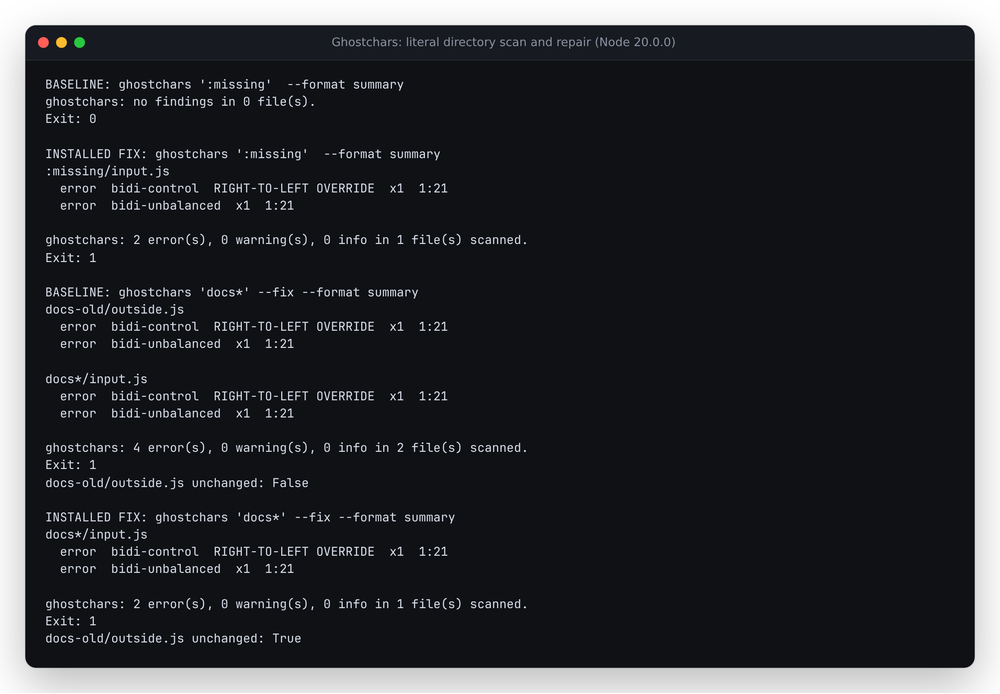

# Keep scans and repairs inside the selected directory

Ghostchars resolves each directory argument as an existing filesystem path,
then uses Git to list its tracked and eligible untracked files. Baseline
`2513948d5bb3e2cb83391d200e7eff838cd7485c` passes that resolved name as a
Git pathspec. Quoting the command-line argument protects it from the shell,
but does not stop Git from interpreting it again.

| Selected directory | Baseline behavior | Corrected behavior |
| --- | --- | --- |
| `:missing` with no `missing` sibling | Zero files, complete, exit 0 despite two files with bidi controls | Both selected files scanned; exit 1 |
| `:victim` with a `victim` sibling | Scans and repairs the sibling instead | Scans and repairs only `:victim` |
| `:(glob)docs*` | Zero files, complete, exit 0 | Both selected files scanned; exit 1 |
| `:(exclude)draft` | Includes unrelated production files | Only the named directory |
| `docs*` beside `docs-old` | Repairs files in both directories | Leaves `docs-old` byte-identical |
| `App` with inherited `GIT_ICASE_PATHSPECS=1` | Also repairs a file in `app` on this case-sensitive filesystem | Only `App` |

The fix uses Git's
[`--literal-pathspecs`](https://git-scm.com/docs/git#Documentation/git.txt---literal-pathspecs)
mode and clears conflicting inherited pathspec modes for that one child
process. Repository and ignore settings remain in effect. There is no change
to Unicode rules, repair bytes, config override patterns or the browser engine.

## Actual CLI replay

[`replay.py`](replay.py) creates 17 disposable synthetic Git repositories,
each once for a scan and once for `--fix`. The selected directory contains
one tracked and one untracked file with a U+202E control, plus an ignored file.
An unrelated sibling contains the same control. Every file has an independently
specified expected byte string after the operation; the replay records complete
JSON findings and before/after hashes, including ignored and unrelated files.
Elapsed report times and disposable absolute directory names are normalized.

| Result | Baseline | Corrected CLI |
| --- | ---: | ---: |
| Runs respecting the selected directory | 10 / 34 | 34 / 34 |
| False-clean scans | 2 | 0 |
| Repair runs changing files outside the selection | 10 | 0 |

Controls cover ordinary names, spaces, bracket/question-mark names and inherited
literal mode. Additional cases exercise a lone colon, nested wildcard names,
literal/exclude/glob pathspec spellings and inherited glob/case modes. These are
constructed filesystem regressions, not a prevalence estimate or public corpus.
The retained results use Git 2.43.0 on case-sensitive WSL2 Linux; reserved filename
spellings and the `App`/`app` pair are not portable to every filesystem.

Retained results: [baseline](results/before.json), [corrected development
bundle](results/after.json), [clean-build and installed-artifact
receipt](results/verification.json), [ordinary source/workflow scan
control](results/ordinary-scope.json).



The screenshot renders [unedited CLI summaries and actual byte comparisons](results/demo.txt)
from [`demo.py`](demo.py). It uses one selected file per case for readability;
the 34-run replay above checks both tracked and untracked inputs.

## Clean build and installed artifact

Implementation revision `f64c533a5f1badde774bb63e962aa3db8d1138e9` was archived
into a fresh directory. With Node 24.21.0, `npm ci`, lint, type checking,
261 tests in 21 files, the library/CLI build and the benchmark smoke command
all completed successfully. All 316 archived files retained their exact bytes,
including the committed CLI bundle after rebuilding it.

`npm pack` produced a 168,688-byte tarball. It was installed into a separate
directory with install scripts disabled; all 53 installed runtime files
matched the clean build. The installed CLI replayed all 34 cases on **Node
20.0.0** and **Node 24.21.0**. Every normalized report, file hash, exit code and
scope verdict matched the retained corrected result. Installed version/reveal
commands and a library scan/sanitize example also passed.

An additional before/after scan of this checkout's 48 source and workflow
files produced byte-identical normalized reports. The receipt records every
input hash. Browser runtime code is unchanged, so no new browser validation or
hosted-demo claim is made. No npm release, tag or hosted deployment is part of
this source correction; package metadata remains 0.1.5.

The package SHA-256 is
`b3cb6d298ec78758587b2ba24eb8f867f8724c31d480e7186f302f5103064089`.
Its CLI SHA-256 is
`a95385f89f406242d26cd02680f67869b92ee80f3ad331986be8ebe43196cf66`.

## Reproduce

```sh
git show 2513948d5bb3e2cb83391d200e7eff838cd7485c:dist/cli.js > /tmp/ghostchars-before.mjs
python3 studies/literal-directories/replay.py --cli /tmp/ghostchars-before.mjs --expect before --output /tmp/before.json
npm ci && npm run build
python3 studies/literal-directories/replay.py --cli dist/cli.js --expect after --output /tmp/after.json
```

The CLI still receives already-expanded shell arguments. Quote literal names
containing wildcard characters, spaces or shell syntax. The GitHub Action's
`paths` input still uses its documented space-separated shell expansion.
Symlinks, oversized/binary inputs, ignore rules and repair-write constraints
retain their existing behavior. Literal Git enumeration is not a sandbox
against concurrent filesystem changes or a replacement for those checks.
