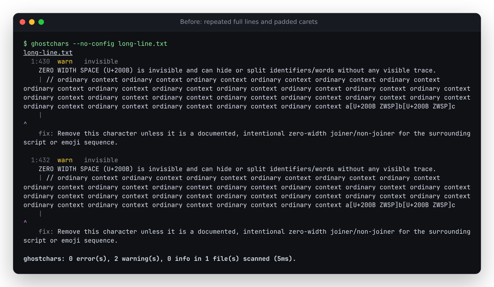
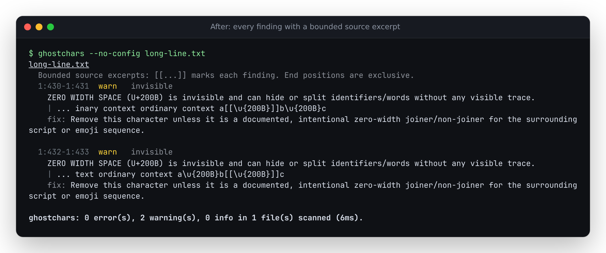

# Keep default diagnostics proportional to the findings

A 6 KB input previously produced 43 MB of terminal output. For each of its
1,500 zero-width-space findings, `formatPretty` rescanned the same complete
line through `reveal`, printed that line again, and padded a caret to the
original source column. The work and output grew roughly quadratically with
the number of findings on that line. The caret also ceased to identify the
right displayed character after an earlier control expanded into a label.

Baseline: `426a453a7679edd1e70e08318073dff9f37ff397`.
Production correction: `a896001f28098af962753da5703188007d5f7898`.
This is source and local installed-package evidence; npm version 0.1.5, tags
and the hosted demo have not been updated.

## Complete command measurements

[measure.py](measure.py) runs the actual bundled CLI, records its exit status
and writes all stdout to disk. The numbers below come from the retained
[baseline](evidence/measure-baseline.json) and
[corrected](evidence/measure-working.json) receipts.

| Input | Input bytes | Findings | Output before | Output after | Seconds before | Seconds after |
| --- | ---: | ---: | ---: | ---: | ---: | ---: |
| Synthetic 500 zero-width spaces | 2,000 | 500 | 4,898,619 | 185,506 | 0.967 | 0.115 |
| Synthetic 1,500 zero-width spaces | 6,000 | 1,500 | 43,196,622 | 558,508 | 6.384 | 0.114 |
| Public `GROK-MEGA.mkd` | 97,121 | 8,946 | 91,457,823 | 3,888,072 | 27.007 | 0.365 |

These are single complete-command observations on 14-logical-CPU WSL2 Linux,
Node 26.7.0, including process startup and stdout writes. They are not isolated
microbenchmarks or scanner-throughput measurements. Other work can affect wall
time; output sizes also include the path and the scan-duration footer. The
footer measures scanning, so it did not reveal the old formatter's long delay.

The public file is unchanged input from the existing
[prompt census](../prompt-census/README.md). Its pinned source and hash, along
with seven other recorded inputs, are in [public-inputs.json](public-inputs.json).
Every byte was checked against the census manifest before replay. No public
prompt text is copied into this study, and no prompt or model API is executed.

## What users see

Every finding still appears, with its original start and exclusive end position.
An excerpt brackets its reported source span with `[[...]]`. This avoids caret
alignment depending on escaped controls, tabs, emoji or wide characters.
Context is limited to 32 UTF-16 units of escaped output on either side; selected
source content gets 80 units, or a head and tail with the omitted source-unit
count. Clipping never splits a surrogate pair or a control escape.

Diagnostic messages and suggestions are limited to 1,200 units of escaped
output and explicitly direct the reader to `--format json` when shortened.
Source files, the underlying findings, decoded payloads, counts and exit status
are unchanged. This is a presentation limit, not a scan limit. A report can
still be large when it contains many findings; `--format summary` remains the
compact grouped view.

The [synthetic long-line input](fixtures/long-line.txt) produces the following
unedited captured output: [before ANSI](evidence/terminal-before.ansi) and
[after ANSI](evidence/terminal-after.ansi). Both screenshots were inspected.





## Compatibility and installed verification

[replay.py](replay.py) checks 17 actual CLI inputs: nine controlled fixtures and
eight hash-verified public documents. They include dense lines, a finding at
column 1,000,001, a long mixed-script identifier, a large decoded payload,
tabs/emoji/CJK/CRLF, clean text and invalid UTF-8.

- All **20,938 findings** appear in the corrected default report, in the same
  order and with their original ranges. A Python oracle independently derives
  their positions by walking the original UTF-16 source units and line breaks.
- **68 format comparisons** are unchanged: JSON (excluding elapsed scan time),
  SARIF, GitHub annotations and summary output for each input. This includes
  complete messages and decoded payloads omitted from shortened human output.
- **Seven actual repair workflows** produce identical statuses, JSON reports
  and repaired file bytes. Original inputs also remain untouched by scans.
- No active ESC, bidi override or selected invisible-control characters leak
  into the tested plain terminal reports.

The same checks pass for the [working build](evidence/working.json),
[clean archive](evidence/clean.json) and separately installed package on
[Node 20.0.0](evidence/installed-node20.json) and
[Node 24.21.0](evidence/installed-node24.json).

The clean archive passes `npm ci`, lint, strict typechecking, all 250 tests,
`npm run build` and the documented clean source scan. The committed single-file
CLI is byte-identical to the rebuilt CLI. All 70 build inputs, 53 built files
and 57 installed package files match. All **52 compiled library files** are
also byte-identical to the baseline: this change is confined to CLI formatting.
The web app has no source changes. See [verification](evidence/verification.json)
and [artifact hashes](evidence/artifacts.json).

The local tarball is 165,816 bytes, SHA-256
`18ede70cb312f1bdc02e41ef6f0fe77b6a6d7b5dc2ccb2cc31b736eb40d638dc`.
It was installed offline into a separate directory. No registry release,
tag creation or hosted deployment was performed.

## Reproduce

Build the baseline and corrected checkouts with `npm ci && npm run build`.
The scripts use Python 3.11 or later and the cached public files from the
census. They do not fetch or execute public inputs.

```sh
python3 studies/pretty-preview/measure.py dist/cli.js . /tmp/pretty-measure /tmp/pretty-measure.json
python3 studies/pretty-preview/replay.py /path/to/baseline/dist/cli.js dist/cli.js . /tmp/pretty-replay /tmp/pretty-replay.json
```

Pass a Node executable as the final argument to choose another runtime. For
the installed replay, replace the corrected `dist/cli.js` argument with the
installed package's CLI. `verify-artifacts.py` takes baseline checkout, clean
checkout, working checkout, installed package directory, tarball and output
receipt. To reproduce only the small terminal example without the public cache:

```sh
node dist/cli.js --no-config studies/pretty-preview/fixtures/long-line.txt
```
