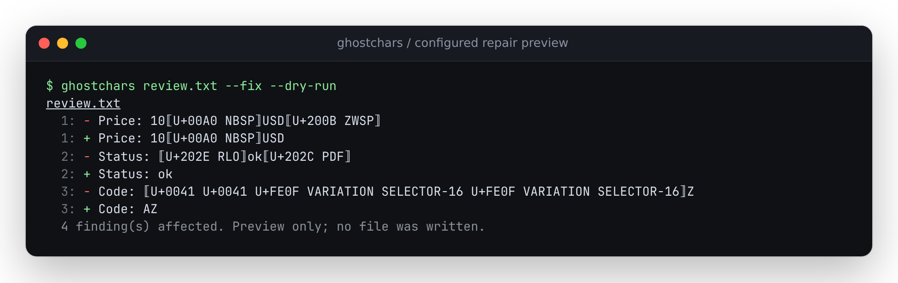

# Configured repairs, checked against actual file bytes

The old CLI scanned with the user's configuration, then repaired with defaults.
When a file contained any fixable finding, `--fix` could delete unrelated
characters that its own configured scan had accepted. Its dry run also replayed
diagnostic ranges as deletions: overlapping findings removed a visible neighbor
in the preview, and a variation-selector finding removed its retained carrier.

These changes are in the source checkout, **unreleased**. The comparison uses
the committed CLI at `1a4a312` and the newly built CLI, both on Node 24.21.0.
[`results.json`](results.json) contains their SHA-256 hashes and every result.
These are repair reproductions, not a detection-accuracy benchmark.

## What changed

The notation below names code points explicitly; it does not rely on a terminal
displaying invisible characters. `ZWSP` is U+200B, `NBSP` is U+00A0 and `RLO` is
U+202E.

| Input and policy | Old behavior | Current behavior |
|---|---|---|
| `a + ZWSP + b`, alongside a bidi finding; `invisible: false` | Deletes the disabled ZWSP | Retains it, removes the bidi controls |
| `price + NBSP + USD + ZWSP`; allow U+00A0 | Deletes both spaces | Retains NBSP, removes ZWSP |
| `a + RLO + b` | Preview says `a`, write produces `ab` | Preview and write both say `ab` |
| `A + VS16 + VS16 + Z` | Preview says `Z`, write produces `AZ` | Preview and write both say `AZ` |
| Invalid encoded bytes plus a fixable character | Decodes with replacement, then overwrites original bytes | Exit 2, original bytes retained |
| A missing explicitly named config file | Uses defaults and proceeds | Exit 2 before modifying files |
| Unfixable lookalike spellings, such as `admin` and U+0430 followed by `dmin` | Green "nothing to fix" dry run, with no findings shown | Names the remaining findings and asks for review |

The sanitizer carries `ScanOptions` through every pass. Its allowlist protects
individual scalars, including the allowed part of a compound finding. Preview
lines come from the resulting text, with retained invisible characters exposed.
Human diagnostics quote terminal controls; annotation filenames use GitHub's
property escaping.



The small [review example](../../examples/repair-policy/review.txt) is synthetic.
Its neighboring configuration allows NBSP. From the repository root:

```sh
(cd examples/repair-policy && node ../../dist/cli.js review.txt --fix --dry-run)
```

Exit 1 is expected here because the original text contains error-level bidi
findings. The preview removes those controls and the stray selectors, keeps
`A`, and shows the retained NBSP on the `+` line.

## Evidence

| Workload | Old CLI satisfies all checks | Current CLI satisfies all checks |
|---|---:|---:|
| 26 controlled cases | 4 / 26 | 26 / 26 |
| 13 modified translation catalogs | 5 / 13 | 13 / 13 |

For exact expected output bytes alone, the old CLI passes 14 of 39 cases and the
current one passes all 39. Some old previews fail even when the write is correct.
Every dry run is also checked for zero file modification. The controlled cases
cover multi-pass repair, partial compound allowlists, astral carriers, mixed
line endings, UTF-8/UTF-16 signatures, four malformed encodings, a literal U+FFFD,
invalid policy, terminal controls and annotation property injection.

The real text is all 13 `diagnosticMessages.generated.json` files from the locked
`typescript@5.9.3` dependency: 4,453,200 original bytes, 908 NBSPs, four ZWSPs and
one C1 control (U+0083 in the Polish catalog). Each input gets two deliberately
inserted bidi controls around its first message. The policy allows NBSP and
disables `invisible` and `control-character`, so the expected repair is exactly
the original catalog. Retaining the C1 control is an explicit test policy, not a
claim that it is desirable text. All other rules retain their defaults.

The old CLI changes preexisting bytes in eight catalogs despite that policy.
The new CLI removes only the two inserted controls in every catalog. Input,
original and output hashes and per-file counts are recorded. Catalogs are read
from the dependency installed by `npm ci`; their text is not copied into this
repository. The modifications are synthetic and do not establish a real attack
against TypeScript.

## Reproduce

From the repository root with Node 24 and Python 3:

```sh
npm ci && npm run build
repair_study_dir=$(mktemp -d)
git show 1a4a312:dist/cli.js > "$repair_study_dir/before.mjs"
python3 studies/repair-policy/verify.py \
  --baseline "$repair_study_dir/before.mjs" \
  --output "$repair_study_dir/results.json"
```

The Python driver imports no ghostchars code. It launches the CLI in separate
processes, writes the configured inputs to temporary directories, and compares
the actual file bytes with explicit expected bytes. The catalogs' expected
output is their unchanged original byte sequence. It exits nonzero on any
candidate failure, missing catalog or unexpected TypeScript version. The
baseline is optional; `--cli` can point at the installed package's bundled CLI.

## Local verification

At code commit `867bc4e`, a separate clean checkout with `npm ci` and
`npm --prefix web ci` passed typechecking, lint, build and all 184 unit checks.
The same suite passed under `de_DE.UTF-8`. The committed CLI matched its fresh
build byte for byte; the source/document self-scan and default 50 MiB benchmark
completed. The README's performance snapshot was refreshed from that run.

`npm --prefix web run test:browser` passed all 30 Chromium/Firefox workflows,
including clipboard and worker recovery, offline edits, and accessibility
at 1440 px and 375 px. The workspace and clean browser builds have identical
contents. Build with `npm --prefix web run build`; output is `web/dist/`.

The clean checkout was packed with `npm pack` and installed into an empty
directory. Its command entry point and library import worked, and running
`verify.py --cli <installed-package>/dist/cli.js` passed the same 39 cases. The
installed CLI hash matches `results.json`. This verifies a local tarball; no
package, branch or site was published.

## Repair contract and limits

- The configuration's `allow` list protects scalars, including a scalar inside
  a larger finding. A protected compound finding may remain reported after
  repair; `sanitize().remaining` describes the final text.
- `false` disables that rule. Another enabled rule can still remove the same
  scalar. A severity override does not disable removal. All matching file
  overrides merge in order and their allowlists accumulate.
- Missing explicit config, unknown keys or rule names, invalid severities and
  invalid Unicode scalar values stop before scanning. An absent default
  `.ghostcharsrc.json` still means the default policy. `--no-config` explicitly
  bypasses configuration.
- Accepted UTF-8 and BOM-marked UTF-16 files retain their encoding, signature
  and original CR/LF bytes. A removal between CR and LF can join those two
  boundaries; the preview compares the actual resulting lines. Binary and
  over-limit files are still skipped and reported.
- Malformed encoded text is not scanned as if replacement characters were the
  original input. It produces a read error and exit 2; `reveal` rejects it too.
- Fix output and exit 0/1 describe the original scan. Rescan after a write to
  inspect what remains. A read or write failure takes precedence with exit 2.
- Repairs write in place, without backups, concurrent-edit detection or a
  transaction across files. An error on one file does not roll back earlier
  files. Preview and review before applying a repair.
- This work does not change Unicode detection heuristics or turn removal into
  a guarantee that text is benign. The browser continues to use default policy.
