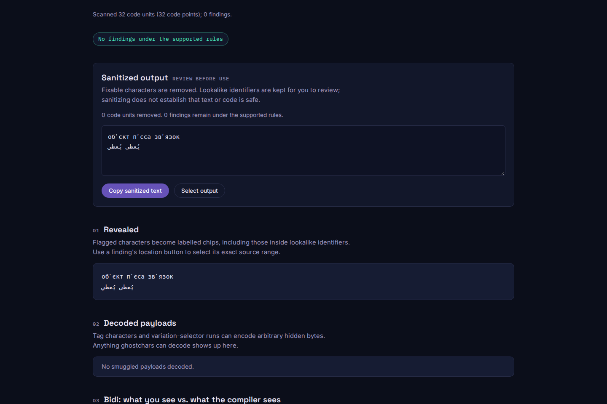

# Shared characters have alternatives, not simultaneous scripts

The baseline at `36d7aa9` reports `обʼєкт` as mixing Cyrillic, Lisu, Thai
and Toto. U+02BC MODIFIER LETTER APOSTROPHE has seven script alternatives;
Cyrillic is one of the four the generator silently drops. The same problem
affects `пʼєса` and `звʼязок`. All three now scan without findings and survive
both repair modes byte-for-byte.

The generator compared the abbreviated values in `ScriptExtensions.txt`
directly with the long names in `Scripts.txt`. Only 21 of 206 source records
survived, some partially. It now resolves every alias through pinned Unicode 17
`PropertyValueAliases.txt` and fails on an unresolved alias instead of dropping
it. `scriptsOf` returns the exact explicit extension set, falling back to the
single Script value when there is no record, including `{Unknown}` defaults.

These distinctions follow [UAX #24 for Unicode 17](https://www.unicode.org/reports/tr24/tr24-39.html).
The exact values come from the versioned
[extension data](https://www.unicode.org/Public/17.0.0/ucd/ScriptExtensions.txt)
and [alias data](https://www.unicode.org/Public/17.0.0/ucd/PropertyValueAliases.txt).
The [generator replay](results/generator.json) records their hashes and sizes.

## Two consumers need different evidence

For word/collision classification, each shared character supplies possible
scripts. If every character has exactly one compatible script in common, the
whole word uses that script. Counting all alternatives as simultaneous scripts
would turn an ordinary Arabic vowel into an apparent Arabic/Syriac mix and
introduce two false collision errors on `يُعطى يُعطي`. That pair occurs in the
unchanged public Arabic corpus and remains quiet after the correction.

For zero-width joiner exemptions, a shared accent's possible use in Syriac does
not establish a Syriac context in a Latin word. The existing primary-Script
policy now uses a separate `scriptOf` lookup. A data-only prototype suppressed
the ZWNJ and ZWJ in `ä‌̈b` and `ä‍̈b`; the final correction keeps those warnings
and removes only the joiners. Persian, foreign-term suffix and virama controls
retain their existing behavior. This does not implement complete ContextJ
validation or resolve every combining-mark context.

| Controlled observation | Baseline | Alias-only library prototype | Final |
| --- | --- | --- | --- |
| Three Cyrillic words with U+02BC | 3 false warnings | Quiet | Quiet |
| Arabic vowel/collision pair | Quiet | 2 false errors | Quiet |
| Latin accent + ZWNJ | 1 warning | Quiet | 1 warning |
| Latin accent + ZWJ | 1 warning | Quiet | 1 warning |
| Cyrillic `а` with Greek-only U+0342 | Missed | 1 warning | 1 warning |

The prototype is a deliberately incomplete library-table substitution, not a
released or proposed CLI build. [Before](results/before.json),
[prototype](results/alias-only-prototype.json) and [after](results/after.json)
retain all 11 controls. The actual final CLI is separately exercised in JSON,
SARIF, GitHub annotation and summary formats, plus dry-run and real repairs.
Warnings retain the CLI's existing exit-0 policy; an exit code alone does not
establish that the scan is quiet. The original input/output text and exact
UTF-16 finding spans are checked.

Warnings involving shared marks no longer list every possible script as if all
were present in the word. They explain that its shared-character choices cannot
satisfy the permitted combinations. Original spellings, code points and names
remain available for review; confusable repair never rewrites visible letters.

## Independent data and real-input checks

The [oracle](oracle.mjs) independently parses the three pinned source files and
compares every Unicode code point with the built lookup functions. All **669
explicit code points in 206 records** now have exact extension sets. All
**1,114,112 code points**, including unassigned/surrogate defaults, match both
properties. The baseline's union of implicit primary values and partial data
matches none of the explicit sets exactly. Its empty unassigned defaults are
recorded separately; that internal difference is not a count of missed attacks.
Implicit values remain neutral in the scanner's script policy.

Ten targeted positive/negative observations also use the host JavaScript
engine's independent `Script_Extensions` regex implementation. The current
runtime agrees with all ten. Node 20.0.0 carries Unicode 15.0/ICU 72.1 and
differs on four: it does not associate U+02BC with Cyrillic/Latin or U+0308 with
Latin/Syriac. The scanner's vendored Unicode 17 lookups still match all pinned
values on that runtime. Native version differences are reported separately
from lookup failures. Host regex token categories and normalization remain
runtime-dependent; this does not claim complete scanner behavior is independent
of its host Unicode version. [Before](results/oracle-before.json),
[after](results/oracle-after.json).

The [complete cached prompt-census replay](results/corpus.json) verifies all
83,494 file digests. Every unrelated rule is identical. The final change is
confined to the previously inspected `L1B3RT4S/GROK-MEGA.mkd`: 34 warning
occurrences added, seven removed, with revised shared-character diagnostics.
All other 83,493 documents, including the Arabic page that exposed the
intermediate regression, have identical complete outputs. The total changes
from 18,583 to 18,610 findings; no error-level finding is added or removed.
This is in-sample compatibility evidence, not new attack discovery or a claim
that every unusual scholarly/phonetic combination is malicious.

[Every changed source span](results/corpus-review.json) was checked against the
original code points. The repaired output of that one changed document is
byte-identical before and after, and all added/removed occurrences are warnings.

```sh
npm ci && npm run build
node studies/script-extensions/replay.mjs . /tmp/scx-after.json --verify
curl -fsSL https://www.unicode.org/Public/17.0.0/ucd/PropertyValueAliases.txt -o /tmp/PropertyValueAliases.txt
curl -fsSL https://www.unicode.org/Public/17.0.0/ucd/ScriptExtensions.txt -o /tmp/ScriptExtensions.txt
curl -fsSL https://www.unicode.org/Public/17.0.0/ucd/Scripts.txt -o /tmp/Scripts.txt
node studies/script-extensions/oracle.mjs . /tmp /tmp/scx-oracle.json --verify
```

With the existing [census cache](../prompt-census/README.md):

```sh
node studies/script-extensions/corpus.mjs BASELINE_ROOT CURRENT_ROOT /tmp/scx-corpus.json
```

The Unicode data license remains in [LICENSE-UNICODE](../../LICENSE-UNICODE).
Package version 0.1.5 alone does not identify this source correction; no npm
release is included.

## Installed artifacts and browser review

The [artifact receipt](results/artifacts.json) records a fresh staged-tree
archive: types, lint, 364 tests, clean self-scan, web types/lint/build and all
42 Chromium/Firefox workflows pass. The tracked CLI equals that clean build.
A separate installation of the packed tarball with `--ignore-scripts` has all
55 `dist/` files and both licenses byte-identical to the archive build. The
normal checkout and archive also produce identical bytes for all 32 web files.

[Node 20.0.0](results/installed-node20.json) and
[Node 26.7.0](results/installed-node26.json) both pass the actual library/CLI
controls and both repair modes. The minimum runtime also passes the complete
[pinned-property oracle](results/installed-oracle-node20.json), separately
retaining its four native-version differences, and the
[ideographic-selector regression replay](results/installed-ivs-node20.json).

The actual browser worker preserves all ordinary Cyrillic and Arabic text,
while retaining the Latin joiner and mixed-lookalike findings. Location buttons
select the exact joiner/whole-token source spans; output selection preserves
the text except for the joiner. Scanning happens offline after page load.
Both engines pass accessibility and overflow checks at 1440px and 375px, with
no page or CSP errors and one real worker. Browser ledgers:
[Chromium](results/browser-chromium.json), [Firefox](results/browser-firefox.json).
All four captures were opened and inspected. The UI retains its existing dark
theme; no production UI code was changed.



[Phone capture](../../docs/assets/script-extensions/firefox-375.png).

```sh
cd web
CAPTURE_SCX_EVIDENCE=/tmp/scx-shots npm run test:browser -- --grep 'script alternatives'
```

These are source and local installed/browser checks. Public source and hosted
bytes require their own verification.
