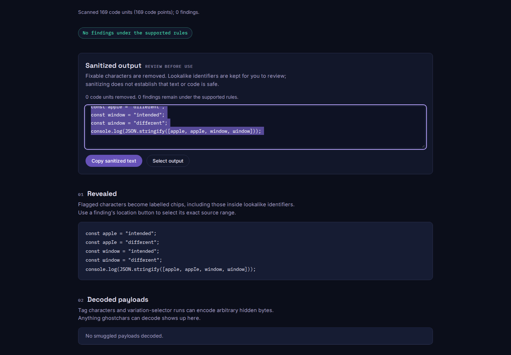
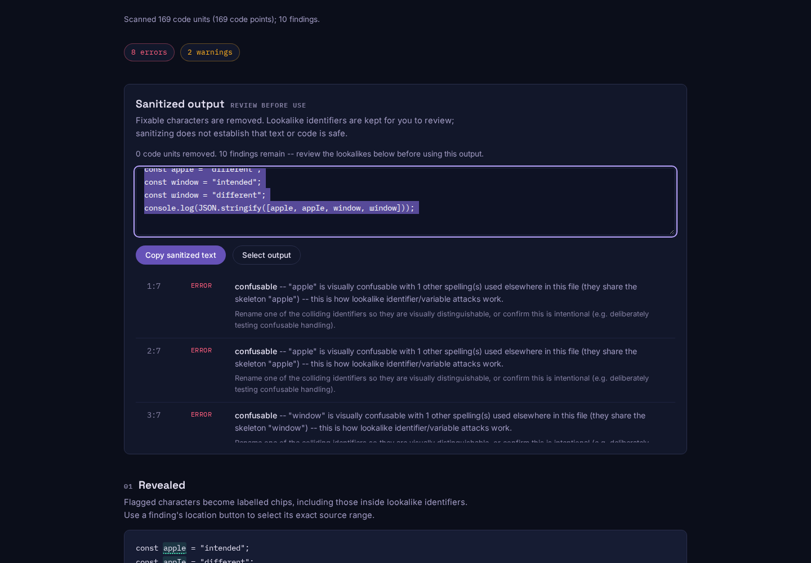

# Recover identifier lookalikes omitted by the old security table

At baseline `cf5a71b65df0bdd3e3f970b29b49db56e6538224`, Ghostchars reported
no findings for the runnable [JavaScript fixture](fixtures/identifiers.mjs).
It declares both `apple` and an all-Cyrillic lookalike, plus `window` and a
spelling beginning with Cyrillic sha. Node executes the different bindings
and prints `["intended","different","intended","different"]`. The scanner's
clean result did not distinguish these confusable identifiers.

The generated security table was pinned to Unicode 16. Its generator and
README incorrectly explained that Unicode 17 security data was unavailable.
That release uses [a different versioned directory](https://www.unicode.org/Public/17.0.0/security/).
The update aligns security and emoji sources with the already-pinned Unicode
17 core data. It changes the lookup table and the shipped CLI bundle; the
scanner's rules and manual identifier-repair policy remain the same.

## What changed

| Mapping | Unicode 16 | Unicode 17 |
| --- | --- | --- |
| U+04CF CYRILLIC SMALL LETTER PALOCHKA | `i` (U+0069) | `l` (U+006C) |
| U+0448 CYRILLIC SMALL LETTER SHA | No mapping | `w` (U+0077) |
| All mappings | 6,355 | 6,565 |

The [upstream confusables file](https://www.unicode.org/Public/17.0.0/security/confusables.txt)
adds 210 mappings and revises 39, removing none. An independent parser checks
every generated entry against that hash-pinned file. [`data.json`](data.json)
retains the full delta and upstream URLs, sizes and SHA-256 hashes.
The [Emoji 17 source](https://www.unicode.org/Public/17.0.0/emoji/emoji-sequences.txt)
has the same three RGI tag sequences as Emoji 16; its generated allowlist is
byte-identical. Other generated tables are unchanged.

[`replay.mjs`](replay.mjs) checks eight cases, executes the fixture, captures
four actual CLI formats and attempts both dry-run and real repair on a copy.
[`before.json`](before.json) and [`after.json`](after.json) retain the output.

| Controlled check | Before | After |
| --- | --- | --- |
| Runnable fixture | 0 findings | 8 collision errors, 2 mixed-script warnings |
| JSON, SARIF, GitHub and summary exit codes | All 0 | All 1 |
| All-Cyrillic word beside `appie` | Obsolete collision | No collision |
| Eight case expectations | 4 match | 8 match |
| Source bytes after `--fix` / `--fix --dry-run` | Unchanged | Unchanged |

These are controlled examples, not discovered malicious programs. Prototype
mappings identify possible lookalikes; actual appearance depends on the font.
Ghostchars remains a heuristic scanner, not a complete UTS #39 conformance
implementation or a guarantee that source code is safe.

## Public text and browser behavior

The existing [prompt census](../prompt-census/README.md) supplies 83,494 cached
documents (155,361,980 bytes). The replay checks every input against the pinned
manifest before scanning it. [`corpus.json`](corpus.json) records two changed
documents: one gets an additional mixed-script warning for
`Swank_district_CHAN` followed by Cyrillic text and `Suffix`; the other keeps
three warnings, with the comparison text corrected from `Jaiibreak` to
`Jailbreak`. Total findings go from 18,582 to 18,583. Error counts and all
unrelated rule findings remain unchanged. This is not evidence of a newly
discovered attack or a general false-positive estimate.

The actual built worker is checked in Chromium 153 and Firefox 155 at 1440px
and 375px, for both the recovered fixture and obsolete collision: eight scans
per build. The HTTP server is stopped before those edits. Finding buttons
select the exact original spellings by keyboard; sanitized output and its
selected text retain every source character. Before/after receipts are
[`browser-before.json`](browser-before.json) and [`browser-after.json`](browser-after.json).
All 13 Chromium and 14 Firefox fetched assets match the tested build. No page
errors, CSP violations, external requests, requests after disconnection,
horizontal overflow or axe violations occur in these checks.

The glyphs' packaged font subsets are explicitly loaded before disconnecting.
Fonts are otherwise loaded lazily by `unicode-range`; a cold offline paste can
attempt additional font requests and use fallback faces. This replay checks
offline scanning with consistent fonts, not offline availability of every
unused glyph subset. It checks keyboard output selection, not the operating
system clipboard.




## Reproduce

Build both the baseline and current source separately. After `npm ci`,
`npm run build`, `npm --prefix web ci` and `npm run web:build`:

```sh
node studies/unicode-security-data/replay.mjs . /tmp/ghostchars-after.json --verify
node studies/unicode-security-data/check-data.mjs /tmp/unicode-sources /tmp/ghostchars-data.json
node studies/canonical-confusables/corpus.mjs BASELINE_ROOT . /tmp/ghostchars-corpus.json
node studies/unicode-security-data/browser.mjs web/dist /tmp/ghostchars-browser.json after /tmp/ghostchars-screens
```

For the data check, save the four upstream files under the cache names listed
in `check-data.mjs`; it verifies their pinned hashes. The corpus command uses
the census's existing cache and manifest. Pass `before` and the baseline web
build to capture the old browser result. Omit `--verify` when recording the old
CLI behavior. Source publication does not release npm packages or deploy the
hosted demo.
