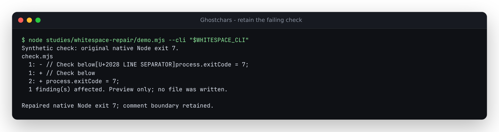

# Deleting whitespace could turn a failing check green

At baseline `fd7b137`, CLI `--fix` deleted every permitted unusual-whitespace
finding. The warning suggested replacement with an ASCII space or newline,
but the actual repair removed the boundary. The reproduction runs the real CLI
on synthetic JavaScript source files and executes each source with native Node
before and after repair.

| Source | Baseline repair | Corrected CLI repair |
| --- | --- | --- |
| `return` + NBSP + `false` | Joins `returnfalse`; native execution raises `ReferenceError` | `return false`; still returns false |
| Line comment + U+2028 + `process.exitCode = 7` | Deletes comment terminator; statement becomes a comment and exits 0 | ASCII newline; check still exits 7 |
| Line comment + U+2029 + the same check | Same false green exit | ASCII newline; check still exits 7 |

JavaScript's [lexical grammar](https://tc39.es/ecma262/multipage/ecmascript-language-lexical-grammar.html#sec-line-terminators)
distinguishes whitespace from line terminators; U+2028 and U+2029 terminate a
single-line comment. Native execution supplies the independent oracle here.
The corpus also includes 15 unusual spaces between `return` and `false`,
ordinary ASCII, configured allowlists/disabled rules and legitimate French,
CJK and braille typography. These are controlled programs, not a claim about
how frequently a production repository contains such code.

## Correction

CLI repair uses the new `sanitize(text, { mode: 'normalize' })` policy.
Flagged unusual spaces become ASCII spaces; NEL, line and paragraph separators
become LF. Other permitted findings use the existing removal behavior.
Allowlisted scalars and disabled rules stay protected on every rescan.
Equal-length replacements count as progress; the result is rescanned until
no permitted edit remains. Previews display the actual proposed source.

The library's default and explicit `mode: 'remove'` retain their documented
deletion contract. `mode: 'keep'` remains inspection only. Existing browser
sanitization uses that default removal policy; this correction changes CLI
repair and adds an explicit library choice. It does not add a browser mode.

This is a textual repair, not a language parser. A normalized character inside
a string changes data, and a language may treat whitespace differently.
NEL is not an ECMAScript line terminator. Review the preview before writing:
word/line boundaries alone cannot establish semantic equivalence or trust.

## Reproduce

```sh
npm ci && npm run build
node studies/whitespace-repair/replay.mjs --cli dist/cli.js --lib dist/index.js --out /tmp/whitespace-repair.json
```

Export `fd7b137` to another directory, install/build there, then pass that
directory's `dist/cli.js` and `dist/index.js` to the same replay with
`--observe-only`. Each run uses its own temporary files, verifies dry runs leave
the originals unchanged, retains full CLI previews/JSON reports, checks exact
repaired bytes and executes original/repaired source with the same Node runtime.
Paths in retained stderr are normalized to the owned case-directory label.

The [baseline](results/before.json) has 18 disagreements across 21 CLI cases
and four library policy cases. Seventeen CLI cases changed native behavior;
the eighteenth is the newly added normalization policy. The
[corrected replay](results/after.json) has zero disagreements. Default removal,
explicit removal and keep policy controls retain their previous results.

## Installed artifact verification

The [verification receipt](results/verification.json) identifies code commit
`26e1ab1`, the packed artifact, source hashes and retained clean-check logs.
A fresh archive passed lint, type checks, all 304 unit checks, library/CLI and
web builds, and all 36 Chromium/Firefox checks, including offline use and
375px gallery/accessibility checks. All six browser-generated screenshots were
inspected. The committed single-file CLI exactly matches its clean rebuild.

| Installed runtime | Actual CLI + native execution | Library policy controls |
| --- | --- | --- |
| Node 26.7.0 | [21 cases; zero disagreements](results/installed-current.json) | Four; zero disagreements |
| Node 20.20.2 | [21 cases; zero disagreements](results/installed-floor.json) | Four; zero disagreements |

All 57 packed files match the clean build and installation; all 44 runtime
source files match the archive. All 32 served files from the production preview
match the tested web build. These browser checks retain the existing removal
policy and are not evidence of a new browser normalization mode.

The [installed-package measurement](results/performance.json) normalizes
100,000 flagged spaces in a 1.2 MB synthetic repeated-word input in 251 ms,
with exact expected output and no remaining findings. A separate
[source measurement](results/source-performance.json) took 325 ms on that
input. Both are single runs on 14-logical-CPU WSL2 Linux, with memory details
retained in the records; they do not establish a general performance bound.
Reproduce with `node studies/whitespace-repair/measure.mjs --lib dist/index.js`.

The [unedited terminal output](../../docs/assets/whitespace-repair.ansi)
was captured from the demo against the installed package, with
`WHITESPACE_CLI` set to its actual `dist/cli.js`. The preview retains an ASCII
newline and native execution still returns exit 7 after applying the repair.



This source correction has no npm release or verified hosted deployment.
Build the library/CLI with `npm run build`; build the existing demo with
`npm run web:build`, producing `web/dist/`.
